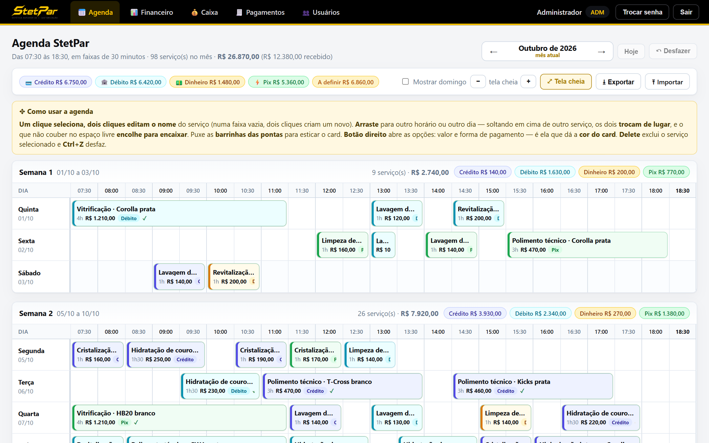
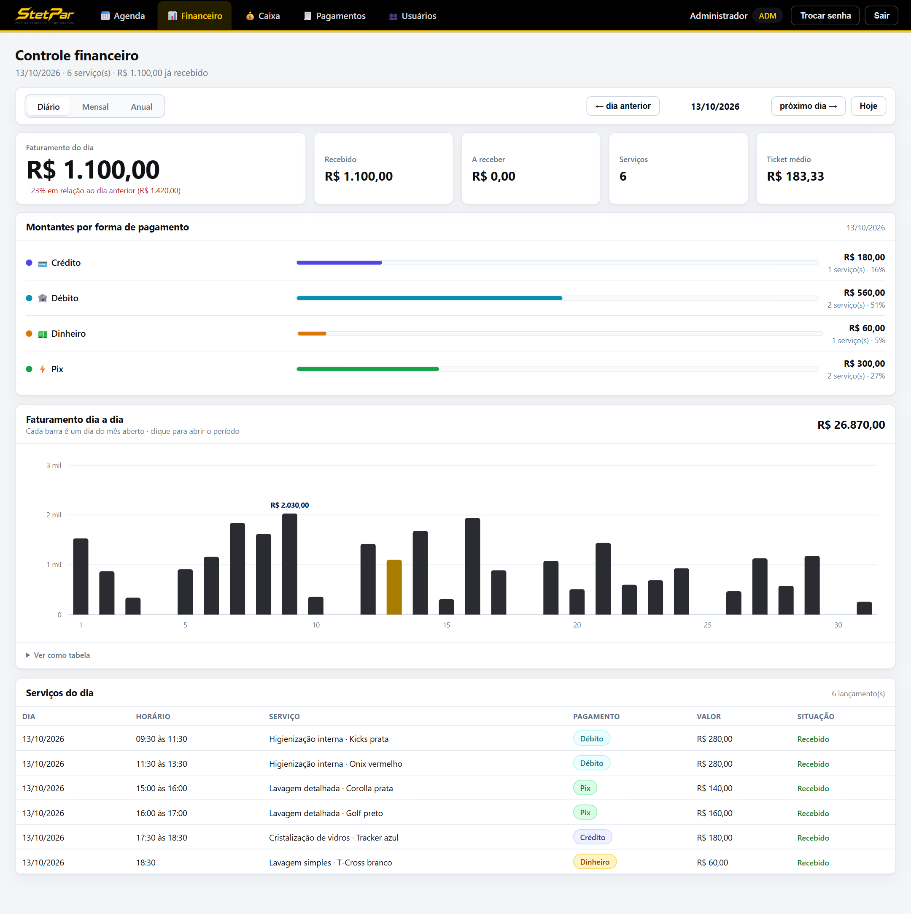
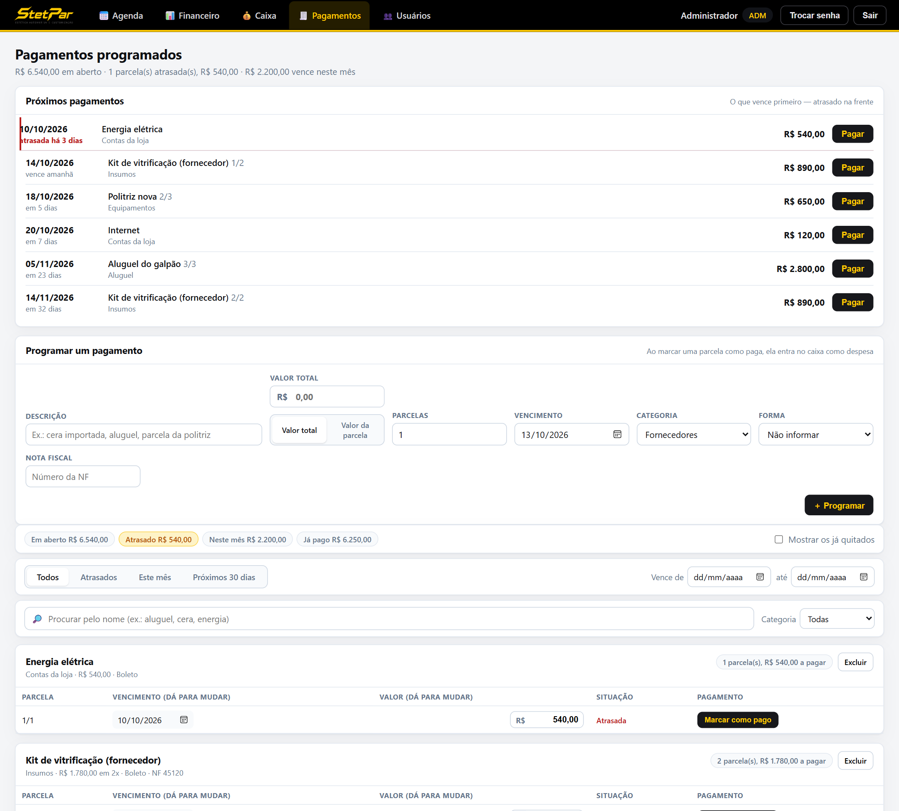
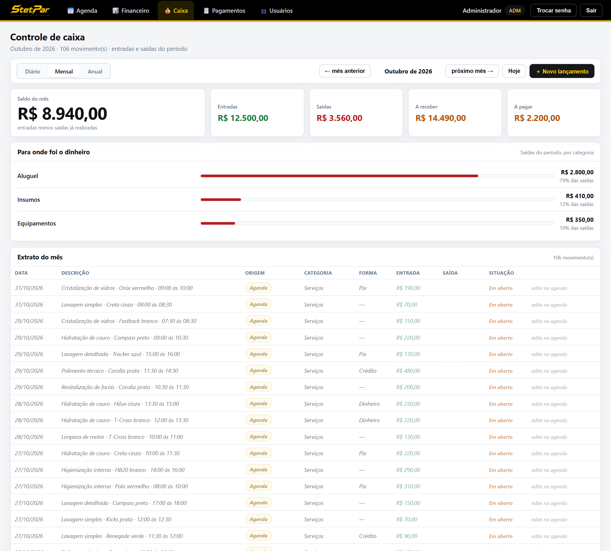
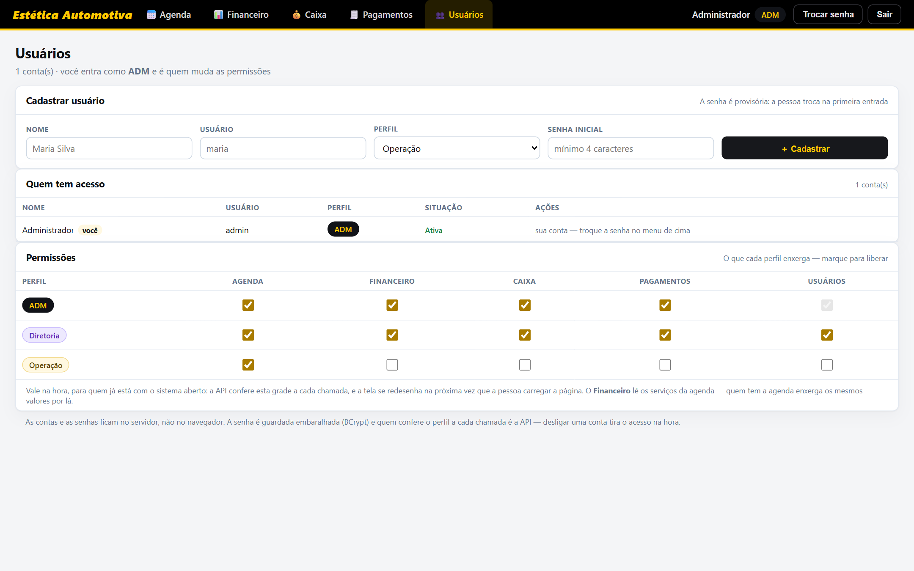

# Agenda para estética automotiva

**Agenda, financeiro, caixa e contas a pagar para uma estética automotiva.** Feito sob
demanda e preparado para ser vendido como produto, por mensalidade.

Kotlin · Spring Boot 3 · React 18 · TypeScript · H2 / PostgreSQL · Flyway · JWT · Server-Sent Events · Cloudflare Tunnel

> Este repositório é a vitrine do projeto: mostra o que ele faz e como foi construído. O
> código-fonte é fechado, porque o sistema é vendido como produto. Os prints usam dados fictícios.

## Meu papel

Conduzi o projeto de ponta a ponta: levantei com o dono e a equipe como a agenda e o
dinheiro circulavam, defini as regras de negócio (o que é forma de recebimento, como uma
parcela vira despesa, quem enxerga o quê), e acompanhei a implantação. O desenvolvimento foi feito com IA (Claude Code), com as regras garantidas
por testes automatizados.

## O problema

A agenda da loja era um caderno e uma planilha. O valor de cada serviço, a forma de
pagamento e o que já tinha sido recebido ficavam espalhados, e o fechamento do mês era feito
na mão. As contas a pagar ficavam fora de tudo isso.

## O que o sistema faz

| | |
| :--- | :--- |
| **Agenda do mês inteiro** | Todas as semanas uma embaixo da outra, os dias na vertical e as faixas de 30 minutos (07:30 às 18:30) na horizontal. Marca com dois cliques, arrasta para outro horário ou dia, estica pelas bordas, troca dois serviços de lugar soltando um em cima do outro, desfaz com Ctrl+Z. No celular, segura o dedo para arrastar. |
| **A cor é a forma de pagamento** | Crédito, débito, dinheiro e pix têm cada um a sua cor, então a semana se lê de longe. As etiquetas de cada semana somam quanto entrou por forma. |
| **Todos veem a mesma agenda, ao vivo** | Quando alguém marca ou move um serviço, as outras telas se atualizam sozinhas, sem F5. |
| **Controle financeiro** | Faturamento do dia, do mês ou do ano, com a variação contra o período anterior, recebido, a receber, ticket médio, montantes por forma de pagamento e gráfico clicável. |
| **Caixa** | Junta três fontes num extrato só: os serviços da agenda, as parcelas pagas e os lançamentos avulsos. Nada é digitado duas vezes. |
| **Pagamentos programados** | Contas parceladas com nota fiscal, parcelas que vencem de mês em mês sem perder centavo, alerta de atrasadas e "Pagar" que joga a despesa direto no caixa. |
| **Permissões configuráveis** | Três perfis (ADM, Diretoria, Operação). O ADM liga e desliga o acesso de cada perfil a cada parte do sistema numa grade, e vale na hora. |

| Financeiro | Pagamentos programados |
| :---: | :---: |
|  |  |

| Caixa | Permissões por perfil |
| :---: | :---: |
|  |  |

## Decisões técnicas

- **Quem barra é a API, não a tela.** Cada rota pertence a uma área, e a API consulta a grade
  de permissões a cada chamada. Tirou a permissão, a próxima requisição responde `403`, mesmo
  para quem já estava com o sistema aberto.
- **Tempo real que atravessa o túnel.** As telas escutam o servidor por *Server-Sent Events*.
  O aviso não carrega dado, só "a agenda mudou", e cada tela busca de novo pela autenticação
  de sempre. A atualização espera o usuário terminar o gesto (arrastar, digitar, menu aberto)
  e as gravações em andamento. Uma batida a cada 25 s mantém a conexão viva atrás da Cloudflare.
- **Dois marcando ao mesmo tempo.** O servidor recusa um serviço que caia em cima de outro e
  diz quem já está lá. A troca de lugar entre dois cards vai num pedido só, tudo ou nada.
- **Só o que a tela mostra viaja.** Cada tela pede só o pedaço de que precisa. Com 10 anos de
  agenda cheia (35 mil serviços), a agenda do mês caiu de 5,8 MB e 2,8 s para **51 KB e 90 ms**.
- **Pronto para rodar sozinho no cliente.** Backup automático diário com poda dos antigos,
  cópia antes de cada migração do banco, limite de tentativas de senha, chave JWT gerada por
  instalação e validação de cada campo antes de o banco reclamar: nenhuma entrada vira erro 500.
- **Otimista na agenda, conservador no caixa.** Na agenda, a mudança aparece na hora e vai
  para o servidor em seguida, numa fila por item. No caixa, cada ação espera a resposta,
  porque dinheiro não pode aparecer na tela antes de estar gravado.

## Como roda

Roda num servidor Windows da empresa, como serviço, e é publicado na internet por um
Cloudflare Tunnel: HTTPS, nenhuma porta aberta
no roteador. Tela, API e banco saem de um único `.jar`.

## Qualidade

- **51 testes no backend** (JUnit 5, sobre a aplicação inteira): primeiro acesso, quem cuida
  da conta de quem, a grade de permissões rota por rota, conflito de horário, parcelamento.
- **71 testes no frontend** (Vitest): as contas da grade, do financeiro e do caixa.
- Bateria de carga com 10 anos de dados gerados e sondagem de entradas inválidas antes de
  cada versão.
- O pacote de produção não é gerado se algum teste falhar.

---

Feito por [Wender de Oliveira](https://github.com/wender95).
